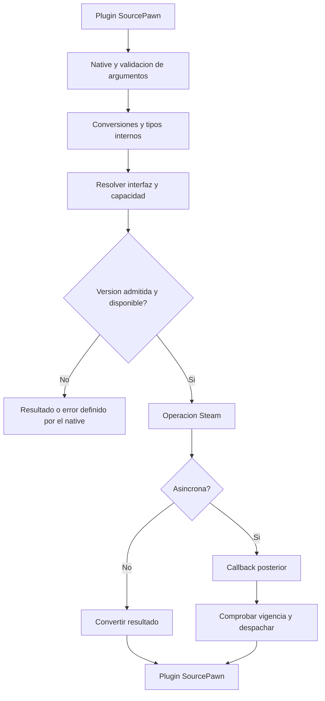

# Arquitectura

SourcePawn invoca los natives del include público. Los módulos C++ validan los
argumentos, convierten identidades/longitudes en tipos internos y resuelven la
capacidad necesaria. Las operaciones asíncronas regresan después por callbacks,
si el propietario y la generación siguen vigentes.

El diagrama resume esa frontera; su fuente son `extension/core/`,
`extension/http/` y los registros de natives. No representa servicios nuevos.

Validar una dirección base SourcePawn **no prueba toda la capacidad anunciada**.
El plugin debe reservar memoria real suficiente; no se puede prometer protección
frente a una capacidad falsa a partir de la conversión de un puntero.

La extensión es dueña de hooks, detours, suscripciones y requests que crea;
no de las interfaces Steam prestadas por el host. El [ciclo de vida](../runtime/lifecycle.md)
evita usar recursos de una generación anterior. La aceptación de una petición
asíncrona no significa datos disponibles. Consulta [tipos](typed-boundary.md),
[HTTP](../http/README.md) y [GC](../game-coordinator/README.md).
