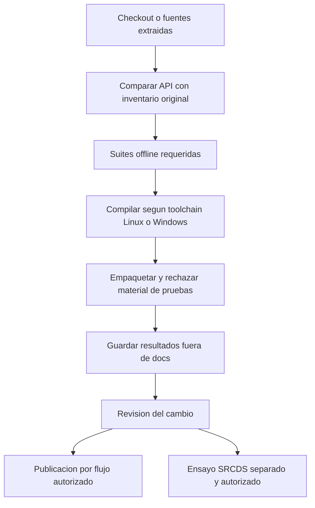

# CI y validación

El workflow conserva builds Linux/Windows, checks de paquete y suites x86.
Todos los pasos de pruebas, build, empaquetado y validación de producto invocan
targets del Makefile raíz; no se mantienen comandos alternativos en CI. Las claves de caché incluyen las rutas nuevas de dependencias/build/empaquetado.
La validación documental se ejecuta localmente con Python, sin un job de CI
ni una dependencia adicional para los builds. Consulta la
[política documental](../maintenance/documentation.md) para ejecutarla.

El pipeline siguiente describe responsabilidades, no un despliegue automático.
Fuente: Makefile, `.github/workflows/main.yml` y orquestador de pruebas. Los
resultados no ejecutados siguen pendientes y SRCDS requiere un ensayo separado.

El orquestador local incluye las pruebas documentales, exige una carpeta nueva
y conserva flags opcionales para
SourceHook/VM y devuelve fallo si una suite requerida falla. Las dependencias
obligatorias no se convierten en skips. El verificador documental no descarga
baselines, opera servidores ni publica; usa solo la biblioteca estándar de Python.
Publicación de artefactos en Actions y publicación de
releases siguen las condiciones existentes del workflow, sin ampliar permisos.

Los paquetes Linux/Windows tienen lista permitida de producto y documentación.
El staging y la validación final rechazan fixtures, SDK, logs y fuentes de tests.
El ZIP de revisión/reversión es una operación local distinta del paquete de
instalación; fuentes y herramientas diagnósticas nunca se mezclan con este último.
Compilar Windows o pasar fixtures locales no acredita ejecución en Windows.

El checkout del SDK está fijado al commit del lock y usa únicamente `sdk_155`.
El job Linux ejecuta los negativos de selección; ambos builds comprueban los
hashes antes de generar producto. El mapa `scripts/package/package-map.json` se
lee desde las fuentes, no desde el ZIP generado, y también forma parte de las
claves de caché. El lock distingue finales de línea de texto de bytes binarios
y entra en las claves de caché de dependencias.

## Notas de canales móviles

`channel/latest` y `channel/develop` conservan sus tags, URLs de release y nombres
estables de ZIP. CI comprueba los dos archivos y el acceso al listado de releases
antes de eliminar la publicación anterior, conservando el tag Git. Recrea la
release como borrador con notas administradas por CI: fecha UTC (ISO 8601), SHA
completo y enlace al commit, y enlace a la ejecución y su intento. Tras cargar
ambos ZIP publica el borrador como Latest o como prerelease Develop. Así la
fecha de publicación de GitHub corresponde a la nueva publicación.

Durante la recreación los enlaces pueden quedar temporalmente indisponibles.
Cambian los IDs internos y se pierden reacciones y contadores de los assets
anteriores; GitHub puede emitir nuevas notificaciones. Si falla una carga, el
borrador no se publica: la release anterior ya ha sido retirada y se requiere
reintentar la ejecución. Las ejecuciones del mismo ref no se cancelan entre sí
para evitar interrupciones durante la sustitución.

La publicación continúa sujeta al éxito de los builds y paquetes Linux/Windows.
Las notas indican que GC remoto está excluido de la aceptación global de L4D2
dedicado, con API conservada por compatibilidad y sin recepción remota acreditada.
La exclusión no es una prueba positiva aprobada ni implica despliegue.
Los releases versionados por tags `v*` mantienen su procedimiento actual.
`make test-release-notes` ejecuta el bloque real del workflow con `gh` y reloj
simulados: no publica, modifica tags ni contacta GitHub.
