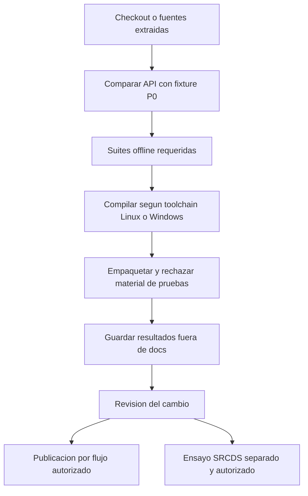

# CI y validación

El workflow conserva builds Linux/Windows, checks de paquete y suites x86.
Las claves de caché incluyen las rutas nuevas de dependencias/build/empaquetado.
La validación documental y el renderizado Mermaid se ejecutan localmente;
no tienen un job en CI ni bloquean los builds. Consulta la
[política documental](../maintenance/documentation.md) para ejecutarlos.

El pipeline siguiente describe responsabilidades, no un despliegue automático.
Fuente: Makefile, `.github/workflows/main.yml` y orquestador de pruebas. Los
resultados no ejecutados siguen pendientes y SRCDS requiere un ensayo separado.

El orquestador local incluye las pruebas documentales, exige una carpeta nueva
y conserva flags opcionales para
SourceHook/VM y devuelve fallo si una suite requerida falla. Las dependencias
obligatorias no se convierten en skips. El verificador documental no descarga
baselines, opera servidores ni publica; el renderizador necesita su toolchain
preinstalado por npm. Publicación de artefactos en Actions y publicación de
releases siguen las condiciones existentes del workflow, sin ampliar permisos.

Los paquetes Linux/Windows tienen lista permitida de producto y documentación.
El staging y la validación final rechazan fixtures, SDK, logs y fuentes de tests.
El ZIP de revisión/reversión es una operación local distinta del paquete de
instalación; fuentes y herramientas diagnósticas nunca se mezclan con este último.
Compilar Windows o pasar fixtures locales no acredita ejecución en Windows.

El checkout del SDK está fijado al commit del lock y usa únicamente `sdk_155`.
El job Linux ejecuta los negativos de selección; ambos builds comprueban los
hashes antes de generar producto. El lock distingue finales de línea de texto
de bytes binarios y entra en las claves de caché de dependencias.
