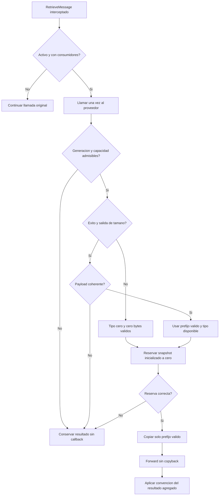

# Game Coordinator

La interfaz opcional permite enviar mensajes, consultar disponibilidad y recuperar
bytes. La API de Game Coordinator se conserva por compatibilidad. Su funcionamiento
depende del soporte del juego y del contexto Steam.

## Aplicabilidad a L4D2 dedicado x86

[Valve describe ISteamGameCoordinator](https://partner.steamgames.com/doc/api/ISteamGameCoordinator)
como una interfaz mayormente obsoleta, conservada para unos pocos juegos. Su
[accesor genérico](https://partner.steamgames.com/doc/api/ISteamClient#GetISteamGenericInterface)
resuelve una interfaz asociada a un usuario/pipe; obtenerla no acredita un
protocolo ni una respuesta del backend para ese contexto.

SteamWorks obtiene la interfaz con handles **GameServer**. Conectar un jugador
al servidor no transfiere a la extensión la sesión GC de su cliente Steam.
La disponibilidad de la interfaz debe distinguirse del soporte del protocolo
del juego y de los componentes que producen y leen mensajes.

| Superficie pública | Qué implementa | Dependencia funcional |
|---|---|---|
| `SteamWorks_SendMessageToGC` | Envía bytes mediante la interfaz GC del GameServer | Requiere el protocolo y esquema de mensajes del juego |
| `SteamWorks_GCSendMessage` | Intercepta llamadas a `SendMessage` | Sin emisor no se dispara espontáneamente |
| `SteamWorks_GCMsgAvailable` | Intercepta `IsMessageAvailable` cuando devuelve true | No es una suscripción directa a `GCMessageAvailable_t` ni sondea la cola automáticamente |
| `SteamWorks_GCRetrieveMessage` | Intercepta llamadas a `RetrieveMessage` | Necesita un lector; la API pública no expone un native de recepción y el frame hook solo reintenta instalar hooks |

Estas funciones conservan utilidad como contratos de transporte/intercepción
cuando otro componente usa la misma interfaz. No constituyen un cliente GC
completo para L4D2 dedicado. La validez de auth, HTTP, identidad o stats mediante
sus interfaces propias no demuestra GC. En particular,
[RequestUserStats pertenece a ISteamGameServerStats](https://partner.steamgames.com/doc/api/ISteamGameServerStats#RequestUserStats).

Un consumidor necesita mensajes y esquemas compatibles con el juego, el contexto
Steam adecuado y un lector de la misma cola. Los IDs y handshakes de otros juegos
no definen el protocolo de L4D2.

## Forward binario de recepción

El hook llama una sola vez al proveedor. Con generación vigente y capacidad
admisible crea un snapshot privado inicializado a cero con la capacidad histórica.
Solo copia el prefijo `messageSize` si el resultado es OK y el tamaño es coherente.
Errores o ausencia de salida de tamaño entregan tipo cero y cero bytes válidos.
Capacidad no equivale a contenido y el array no es una cadena NUL.

El límite es 2147483644 bytes por redondeo a celdas Pawn con tamaño firmado.
Una capacidad inválida, payload incoherente o reserva fallida omite el callback
y conserva el resultado SDK. El snapshot no tiene copyback; un consumidor no
puede modificar el buffer del proveedor. La validación del puntero base no prueba
la reserva completa que anunció el llamador.

El hook mantiene su convención de resultado agregado: cero conserva el resultado
original; un agregado -1 se convertiría en OK; otro no cero lo sustituye. Sin
embargo el forward real es **ET_Event**: la agregación parte de cero y un retorno
negativo de un consumidor no llega como -1 al hook. No prometer que devolver -1
individualmente fuerce OK. Las pruebas con VM real distinguen ambas capas.

Fuente del diagrama: `extension/hooks/swgchooks.cpp`. Muestra el snapshot local,
no el intercambio de mensajes remotos.

Regresiones: `hooks_lifecycle_test.cpp`, `http_gc_boundary_test.cpp` y
`auth_forward_test.cpp` con VM real. Los controles negativos reproducen la
exposición de la cola no inicializada sin depender de un checkout antiguo.
