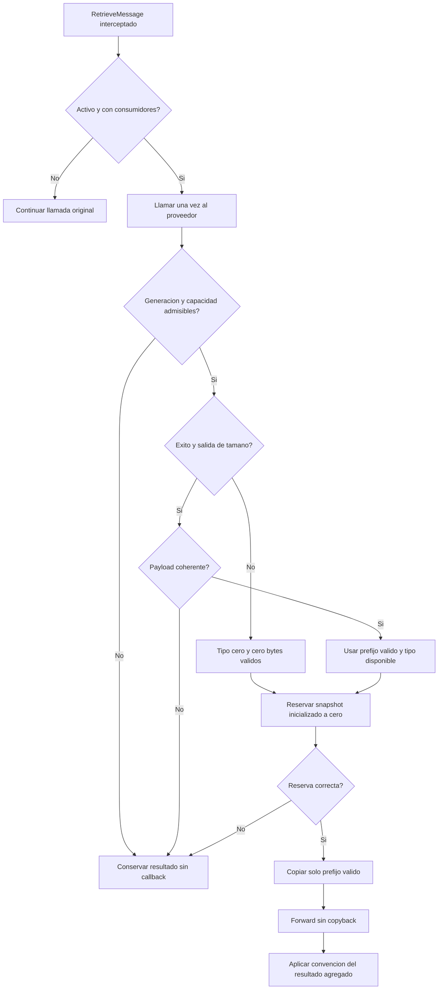

# Game Coordinator

La interfaz opcional permite enviar mensajes, consultar disponibilidad y recuperar
bytes. Su presencia no implica que el backend remoto de L4D2 emita mensajes.
**GC remoto está excluido de la aceptación global de L4D2 dedicado**. La API
se conserva por compatibilidad, sin recepción remota acreditada. El proveedor
local y la cola vacía validan contratos locales, no el protocolo remoto; las
pruebas de ABI, marshalling, buffers y ciclo de vida siguen vigentes.

## Aplicabilidad a L4D2 dedicado x86

La investigación del 2026-11-17 no identificó un escenario reproducible de
recepción GC remota en el SRCDS Linux x86 examinado. Esto no demuestra que todo
backend GC de L4D2 sea inexistente: distingue transporte, contexto Steam y
rutas activas del motor. Por decisión de alcance del 2026-11-17, GC remoto
no es requisito para cerrar la aceptación global de L4D2 dedicado. Se clasifica
como excluido, sin un escenario compatible identificado ni una recepción positiva
aprobada. Reabrir su aceptación requeriría un escenario y evidencia propios.

[Valve describe ISteamGameCoordinator](https://partner.steamgames.com/doc/api/ISteamGameCoordinator)
como una interfaz mayormente obsoleta, conservada para unos pocos juegos. Su
[accesor genérico](https://partner.steamgames.com/doc/api/ISteamClient#GetISteamGenericInterface)
resuelve una interfaz asociada a un usuario/pipe; obtenerla no acredita un
protocolo ni una respuesta del backend para ese contexto.

En el binario dedicado `matchmaking_ds_srv.so` examinado, SHA256
`19d589338d9435582ceaf7268b66bd4ba92f5751aac01fa3fc8cec67494f0b0c`,
`SteamApiContext_Init()` es un stub y `GGCClient()` devuelve nulo. Las rutas
`CDatacenter::RequestStart`, `RequestUpdate` y `Update` comprueban ese resultado
antes de usar el cliente GC. En la variante `matchmaking_srv.so`, SHA256
`7f7c15dc95cc745440baa96dd06f36dea78d0dbf16b90604a5de426e45b2013c`,
`GGCClient()` devuelve un objeto y la inicialización resuelve GC con
`SteamAPI_GetHSteamUser`/`SteamAPI_GetHSteamPipe`. Esa variante no es el módulo
mapeado por el dedicado observado. La evidencia se limita a esos binarios;
no afirmar que todas las versiones/plataformas carezcan de otra ruta.

SteamWorks usa los handles **GameServer**, no los del cliente del jugador.
Conectar una cuenta al servidor no transfiere su sesión GC a la extensión.
El ensayo con interfaz disponible, entrada de una cuenta y cambio de mapa en
el mismo proceso mantuvo la cola vacía y cero mensajes GC observados.

| Superficie pública | Qué implementa | Límite en el dedicado examinado |
|---|---|---|
| `SteamWorks_SendMessageToGC` | Envía bytes mediante la interfaz GC del GameServer | No define protocolo L4D2, handshake ni una respuesta; no hay intercambio remoto acreditado |
| `SteamWorks_GCSendMessage` | Intercepta llamadas a `SendMessage` | Sin emisor no se dispara espontáneamente |
| `SteamWorks_GCMsgAvailable` | Intercepta `IsMessageAvailable` cuando devuelve true | No es una suscripción directa a `GCMessageAvailable_t` ni sondea la cola automáticamente |
| `SteamWorks_GCRetrieveMessage` | Intercepta llamadas a `RetrieveMessage` | Necesita un lector; la API pública no expone un native de recepción y el frame hook solo reintenta instalar hooks |

Estas funciones conservan utilidad como contratos de transporte/intercepción
cuando otro componente usa la misma interfaz. No constituyen un cliente GC
completo para L4D2 dedicado. La validez de auth, HTTP, identidad o stats mediante
sus interfaces propias no demuestra GC. En particular,
[RequestUserStats pertenece a ISteamGameServerStats](https://partner.steamgames.com/doc/api/ISteamGameServerStats#RequestUserStats).

Antes de una nueva prueba positiva se necesita un mensaje y esquema de L4D2
compatibles con el contexto GameServer, un escenario que autorice su respuesta
y un lector de esa misma cola. Un ensayo con cliente/listen-server sería otra
aceptación y requeriría comprobar también que usa la misma instancia que la
extensión. No trasladar IDs/handshakes de TF2, CS o Dota, ni contar proveedores
locales como Steam remoto. Se conserva la API pública y sus comprobaciones.

## Forward binario de recepción

El hook llama una sola vez al proveedor. Con generación vigente y capacidad
admisible crea un snapshot privado inicializado a cero con la capacidad histórica.
Solo copia el prefijo `messageSize` si el resultado es OK y el tamaño es coherente.
Errores o ausencia de salida de tamaño entregan tipo cero y cero bytes válidos.
Capacidad no equivale a contenido y el array no es una cadena NUL.

El límite es 2147483644 bytes por redondeo a celdas Pawn con tamaño firmado.
Una capacidad inválida, payload incoherente o reserva fallida omite el callback
y conserva el resultado SDK. El snapshot no tiene copyback; un consumidor no
puede modificar el buffer del proveedor. La validación del puntero base no prueba
la reserva completa que anunció el llamador.

El hook mantiene su convención de resultado agregado: cero conserva el resultado
original; un agregado -1 se convertiría en OK; otro no cero lo sustituye. Sin
embargo el forward real es **ET_Event**: la agregación parte de cero y un retorno
negativo de un consumidor no llega como -1 al hook. No prometer que devolver -1
individualmente fuerce OK. Las pruebas con VM real distinguen ambas capas.

Fuente del diagrama: `extension/hooks/swgchooks.cpp`. Muestra el snapshot local,
no el intercambio de mensajes remotos.

Regresiones: `hooks_lifecycle_test.cpp`, `http_gc_boundary_test.cpp` y
`auth_forward_test.cpp` con VM real. Los controles negativos reproducen la
exposición de la cola no inicializada sin depender de un checkout antiguo.
