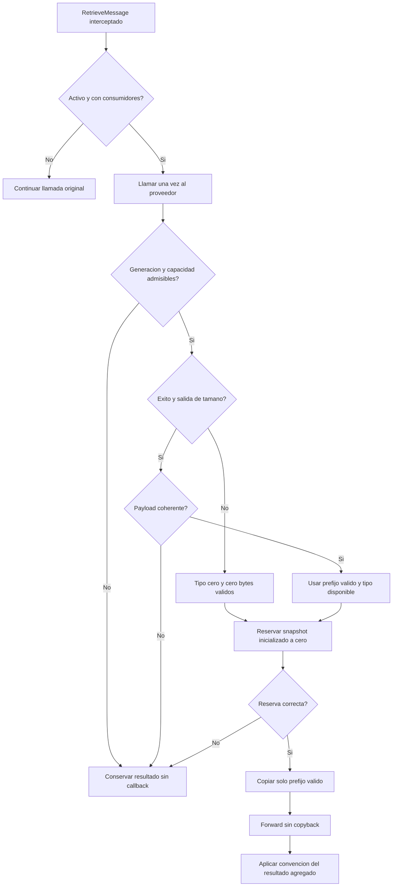

# Game Coordinator

La interfaz opcional permite enviar mensajes, consultar disponibilidad y recuperar
bytes. Su presencia no implica que el backend remoto de L4D2 emita mensajes.
**La recepción positiva remota sigue pendiente**; proveedor local y cola vacía
validan contratos locales, no el protocolo remoto.

## Forward binario de recepción

El hook llama una sola vez al proveedor. Con generación vigente y capacidad
admisible crea un snapshot privado inicializado a cero con la capacidad histórica.
Solo copia el prefijo `messageSize` si el resultado es OK y el tamaño es coherente.
Errores o ausencia de salida de tamaño entregan tipo cero y cero bytes válidos.
Capacidad no equivale a contenido y el array no es una cadena NUL.

El límite es 2147483644 bytes por redondeo a celdas Pawn con tamaño firmado.
Una capacidad inválida, payload incoherente o reserva fallida omite el callback
y conserva el resultado SDK. El snapshot no tiene copyback; un consumidor no
puede modificar el buffer del proveedor. La validación del puntero base no prueba
la reserva completa que anunció el llamador.

El hook mantiene su convención de resultado agregado: cero conserva el resultado
original; un agregado -1 se convertiría en OK; otro no cero lo sustituye. Sin
embargo el forward real es **ET_Event**: la agregación parte de cero y un retorno
negativo de un consumidor no llega como -1 al hook. No prometer que devolver -1
individualmente fuerce OK. Las pruebas con VM real distinguen ambas capas.

Fuente del diagrama: `extension/hooks/swgchooks.cpp`. Muestra el snapshot local,
no el intercambio de mensajes remotos.

Regresiones: `hooks_lifecycle_test.cpp`, `http_gc_boundary_test.cpp` y
`auth_forward_test.cpp` con VM real. Los controles negativos reproducen la
exposición de la cola no inicializada sin depender de un checkout antiguo.
