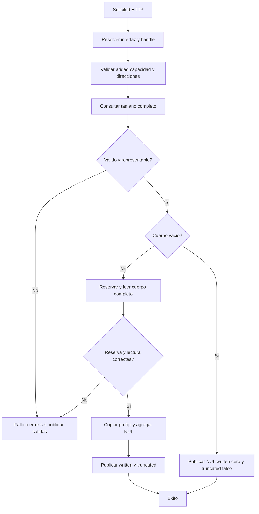

# HTTP y buffers

Los requests son handles propiedad del plugin y de su generación de runtime.
Configura método/URL, callbacks y contexto antes de enviar. Solicitud aceptada,
estado HTTP y lectura del body son resultados distintos. Ver [callbacks](callbacks.md)
y [streaming](streaming.md).

`SteamWorks_GetHTTPResponseBodyData` lee bytes, sin garantizar NUL. Su longitud
debe ser el **tamaño completo exacto** consultado con `GetHTTPResponseBodySize`;
pasar solo el prefijo que cabe no es una lectura válida del SDK.

## Helper textual

`SteamWorks_GetHTTPResponseBodyString(request, body, length, written, truncated)`
requiere los cinco argumentos. Valida aridad, capacidad y direcciones según la
precedencia nativa, consulta el tamaño completo y lo lee en un temporal antes de
copiar hasta `length - 1` bytes. En éxito agrega NUL; `written` cuenta bytes
copiados sin NUL, `truncated` indica pérdida del resto. No cuenta caracteres UTF-8.
En fallo de consulta, reserva o lectura conserva destino y ambas salidas. El body
vacío produce NUL, cero y false. Un tamaño completo superior a 2147483647 provoca
error antes de reservar. El temporal consume memoria proporcional al cuerpo:
no hay garantía de inmunidad a agotamiento de memoria. Requiere respuesta
completada no streaming.

Ejemplo para texto, compilable dentro de un plugin con `<steamworks>`:

```sourcepawn
void PrintBody(Handle request)
{
    char body[2048];
    int written;
    bool truncated;
    if (SteamWorks_GetHTTPResponseBodyString(request, body, sizeof(body), written, truncated))
        PrintToServer("bytes=%d truncado=%d body=%s", written, truncated, body);
}
```

El diagrama resume el helper textual en `extension/http/swhttprequest.cpp`;
no describe RawData ni streaming. Leer todo precede al truncamiento local.



Para RawData con uso textual reserva NUL adicional y procesa solo si cabe todo:

```sourcepawn
void PrintRawBody(Handle request)
{
    int size;
    char body[1024];
    if (SteamWorks_GetHTTPResponseBodySize(request, size) && size >= 0 && size < sizeof(body))
    {
        if (size == 0 || SteamWorks_GetHTTPResponseBodyData(request, body, size))
        {
            body[size] = '\0';
            PrintToServer("body=%s", body);
        }
    }
}
```

El plugin es responsable de respaldar la capacidad anunciada con memoria real.
Un HTTP 200 no prueba lectura correcta. Las regresiones estrictas y sus controles
negativos viven en `test-typed-boundary.sh` y `test-http-stream-context.sh`.
