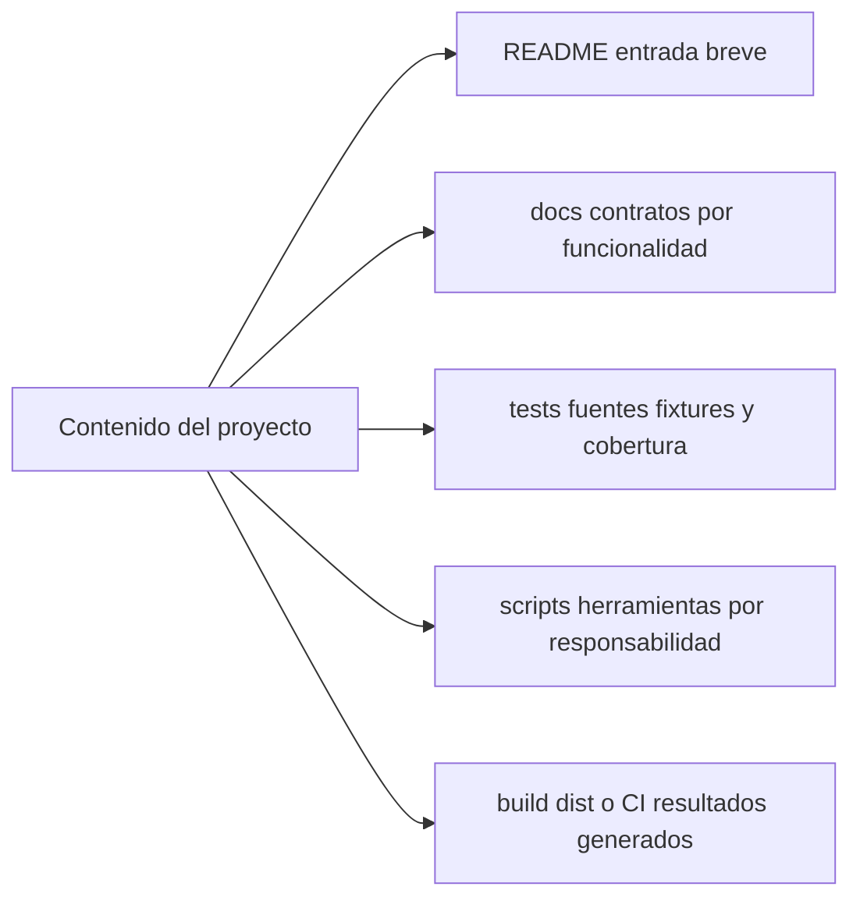
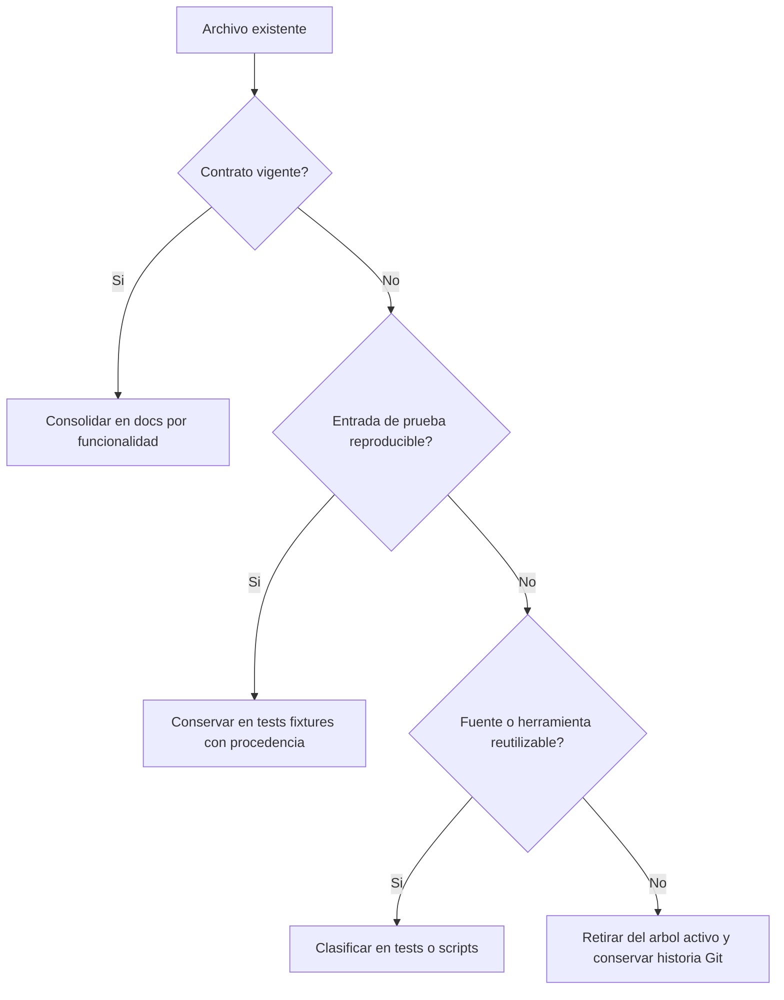

# Política documental

Los nombres de rutas usan inglés y kebab-case; el contenido es español con los
identificadores reales del código. Cada funcionalidad tiene un contrato canónico:
objetivo, entradas/salidas, errores, propiedad, ejemplo verificable, límites y
referencias de implementación/pruebas. No crear páginas vacías por completar un árbol.

El siguiente mapa define responsabilidades editoriales; fuente: estructura del
repositorio. Los resultados de ejecución tienen una vida distinta de los contratos.



Antes de retirar un archivo busca consumidores, dependencias transitivas y hashes.
La extensión JSON no decide si algo es descartable. Un baseline API, schema,
perfil o traza consumida es un fixture; un resultado sin consumidor se regenera.
La decisión editorial se resume así:



Las referencias históricas necesarias deben fijar SHA. No crear `docs/archive`
ni trasladar todo a una carpeta archive dentro de tests. La cobertura debe separar implementado,
probado con dobles, VM/SourceHook y observado en SRCDS; GC remoto permanece pendiente.
Las rutas privadas, PIDs y diarios de checkpoints no son documentación de producto.

Los diagramas permanecen editables como bloques Mermaid en Markdown, con objetivo,
fuente y resumen textual. Revisa su representación en GitHub cuando cambien.
El verificador local comprueba enlaces, anclas, referencias al código y límites
del contenido distribuible usando solo la biblioteca estándar de Python:

```bash
python3 scripts/tools/check-documentation.py
```

Este comando no valida la sintaxis ni el renderizado Mermaid.

## Contenido apto para publicación

Usa nombres genéricos para instancias, paquetes y rutas de ejemplo. No publiques
nombres de contenedores o hosts propios, paths de cuentas/volúmenes locales ni
configuraciones de una instalación concreta. Conserva autoría, licencias y URLs
de repositorios públicos. Los fixtures que necesiten observaciones de módulos
pueden omitir identificadores locales, documentando campos saneados y actualizando
los hashes de documentos transitivos; no cambies medidas o flags de aceptación.
Las recetas de harnesses reciben la configuración específica como entrada explícita.
